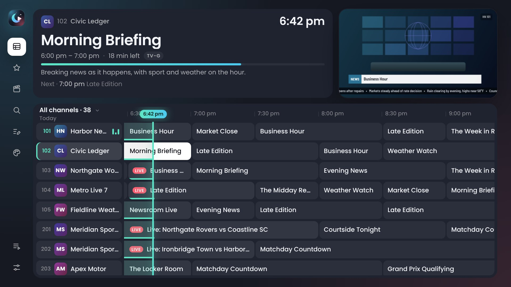
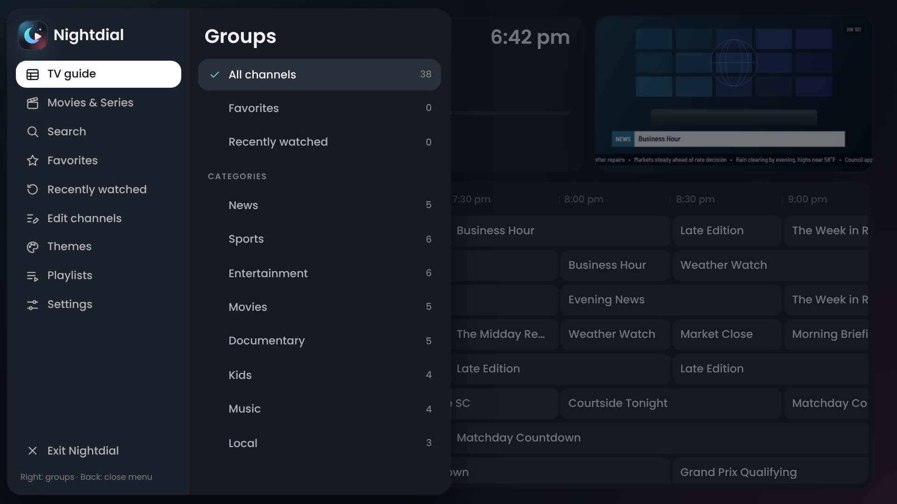
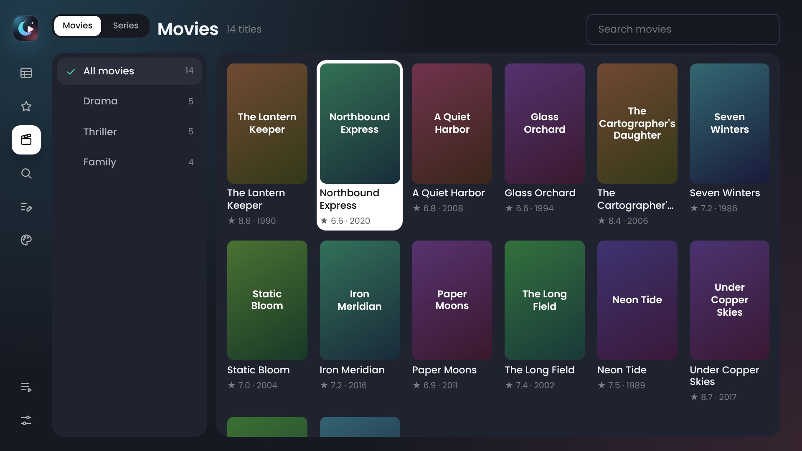
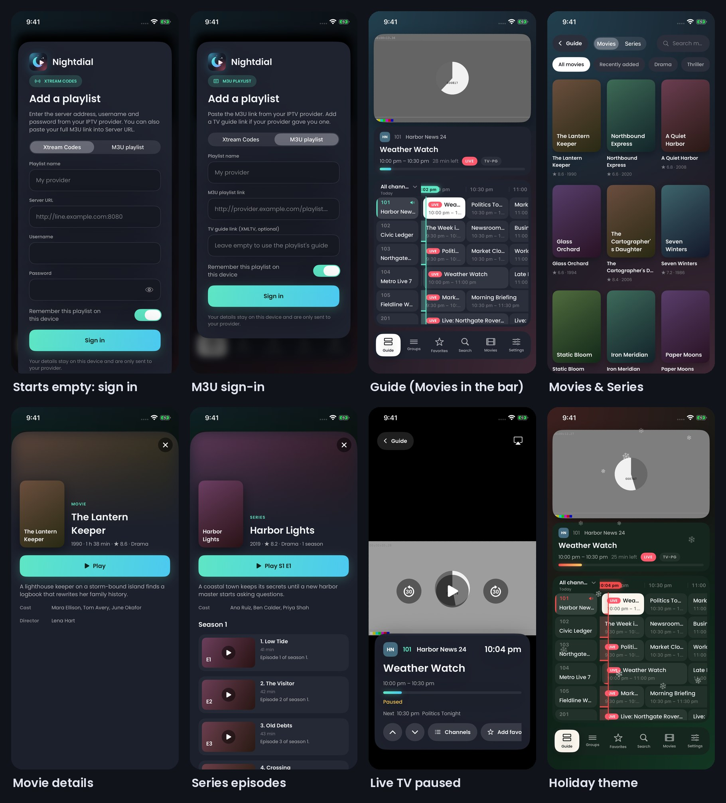
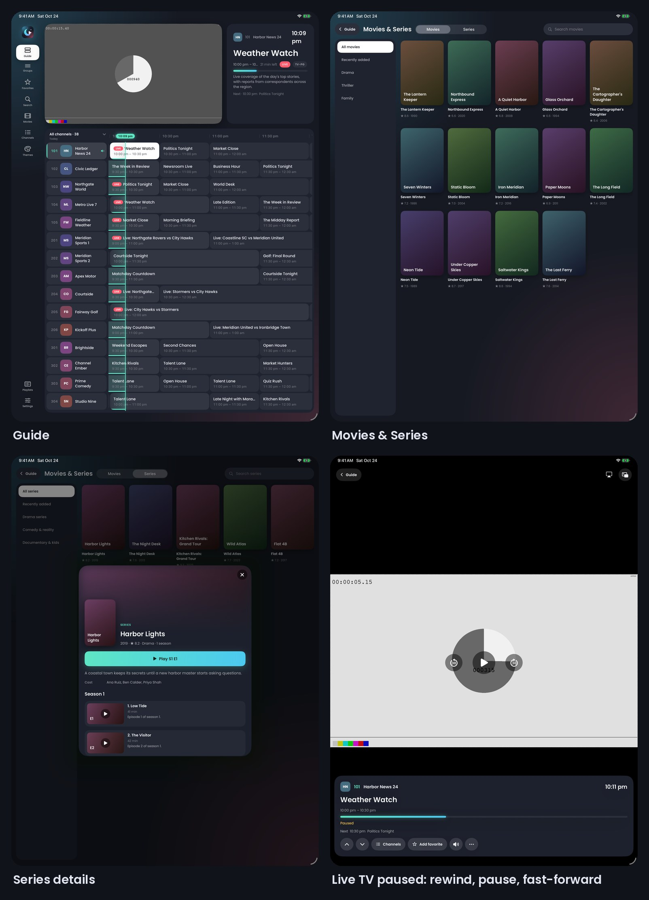

  

  <b>Nightdial</b> is an IPTV player with a full TV guide for <b>Fire TV</b>, <b>iPhone</b>, <b>iPad</b> and the <b>web</b>. 
  Sign in with Xtream Codes or an M3U playlist, browse the guide, watch movies and series, and pause or rewind live TV.

  <a href="https://github.com/S515BX/turner/releases/download/firetv/Nightdial-FireTV.apk"><b>Fire TV app</b></a> ·
  <a href="https://github.com/S515BX/turner/releases/download/ios/Nightdial.ipa"><b>iPhone &amp; iPad app</b></a> ·
  <a href="web/"><b>Web version</b></a>

> Nightdial was called **Tuner** before. Old `Tuner-FireTV.apk` and `Tuner.ipa` links still download the newest build.

## Screenshots

  

  
  

  

  

Screenshots use the built-in sample channels. Nightdial doesn't include any channels; use it with a service you subscribe to.

## Features

- **Two ways to sign in**: Xtream Codes (server, username, password) or an M3U playlist link with an optional XMLTV guide link. Compressed `.xml.gz` guides work, and a `get.php` M3U link signs in with Xtream Codes automatically. The app starts empty, with no demo.
- **Full TV guide (EPG)**: a scrolling grid of what's on now and next, catch-up for channels whose provider keeps recordings, search across channels and programs, and jumping to a channel by number.
- **Movies & Series**: shows up when your subscription includes them. Browse by category, search, see details, seasons and episodes, and pick up where you left off.
- **Pause and rewind live TV**: channels whose stream keeps a buffer rewind instantly; channels with catch-up can go back further, 5 minutes at a time. **Back to live** jumps to now.
- **Your channels, your way**: favorites in your own order, hide channels or whole groups, and sort by provider order, number or A–Z.
- **Themes**: everyday themes plus holiday themes that can switch on by themselves in season, with highlight and menu colors, six fonts, interface size, and holiday decorations.
- **Fire TV**: built for the remote. Video plays in Android's own player, so Dolby audio, H.265 and MPEG-TS streams work.
- **iPhone and iPad**: AirPlay, Picture in Picture and 120 Hz ProMotion.
- **Private and secure**: passwords and playlist links are stored encrypted on your device (Keychain on iPhone, Android Keystore on Fire TV) and only ever sent to your provider. Fire TV backups are off, the app page blocks injected scripts, and it can't be steered to other websites.

## Download

GitHub builds the apps automatically every time something in `ios/` or `firetv/` changes. Only builds from the `main` branch are published; builds from `dev` are for testing (their files and iPhone screenshots are attached to the workflow run, and the screenshots are also on the `ci-ios-shots` branch). The newest builds are always on the **Releases** page.

| App | Download | Install with |
| --- | --- | --- |
| iPhone and iPad | [Nightdial.ipa](https://github.com/S515BX/turner/releases/download/ios/Nightdial.ipa) | [Sideloadly](https://sideloadly.io) (signs it with your Apple ID) |
| Fire TV | [Nightdial-FireTV.apk](https://github.com/S515BX/turner/releases/download/firetv/Nightdial-FireTV.apk) | Downloader app or adb |
| Web | `web/` folder | `node server.js`, then open http://localhost:8080 |

To build again without changing anything: **Actions** tab → pick the workflow → **Run workflow**.

### iPhone and iPad (Sideloadly)

1. Download `Nightdial.ipa` from Releases on your computer.
2. Install [Sideloadly](https://sideloadly.io). On Windows it needs iTunes and iCloud from Apple's website, not the Microsoft Store versions.
3. Plug in your iPhone, drag `Nightdial.ipa` into Sideloadly, enter your Apple ID and press **Start**.
4. On the iPhone: Settings → General → VPN & Device Management → your Apple ID → **Trust**. Turn on Developer Mode if asked (Settings → Privacy & Security) and restart.
5. With a free Apple ID the app lasts 7 days. Turn on Sideloadly's automatic refresh, or press Start again before then.

On iPhone, most M3U channels need to be HLS (`.m3u8`) streams; Xtream-style `.ts` links are switched to `.m3u8` automatically. Movies in `.mkv` format play on Fire TV and the web but not on iPhone.

### Fire TV

1. On the Fire Stick: Settings → My Fire TV → About, select the device name 7 times. Then in **Developer options** turn on **Apps from Unknown Sources** (or allow the Downloader app to install apps).
2. Install the free **Downloader** app from the Amazon Appstore.
3. In Downloader, enter the APK link from the **firetv** release:
   `https://github.com/S515BX/turner/releases/download/firetv/Nightdial-FireTV.apk`
   (This works because the repository is public. Alternatively, install from a computer with
   `adb connect <fire-stick-ip>` then `adb install -r Nightdial-FireTV.apk`.)

New builds install over the old one and keep your playlists and favorites.

**On the remote**

| Button | In the guide | In full screen |
| --- | --- | --- |
| ↑ ↓ | Move between channels | Change channel |
| ← → | Earlier and later programs (← from what's on now opens the menu) | ← channel list |
| OK | Watch, or open program details | Channel options: favorite, pause, back to live, hide, audio track, stream format |
| ▶❚❚ | Watch the selected channel | Pause and play |
| ◀◀ ▶▶ | Earlier programs and catch-up, later programs | Rewind and fast-forward |
| Back | Back to now, then the menu | Back to the guide |
| ☰ | Program details | Channel options |

**Exit Nightdial** is at the bottom of the menu.

## Look and channels

- **Themes & look** (menu → Themes): everyday themes plus holiday themes (New Year, Valentine's, St. Patrick's, Easter, 4th of July, Halloween, Thanksgiving, Christmas) that can switch on by themselves in season, highlight and menu colors, six fonts, interface size, and holiday decorations.
- **Edit channels** (menu → Edit channels): put favorites in your own order, hide channels or whole groups, and sort channels by provider order, number or A–Z.

## What's inside

- `ios/`: SwiftUI app (iOS 16+). Open `Tuner.xcodeproj` in Xcode 16+ if you have a Mac.
- `firetv/`: Android TV app for Fire TV (Fire OS 5+). Opens in Android Studio.
- `web/`: browser version with a small Node.js relay for your provider.
- `brand/`: the Nightdial logo (`icon.svg`) and the scripts that render the app icons, the Fire TV banner and this page's banner.
- `docs/`: images for this page.

Nightdial doesn't include any channels. Use it with a service you subscribe to.
