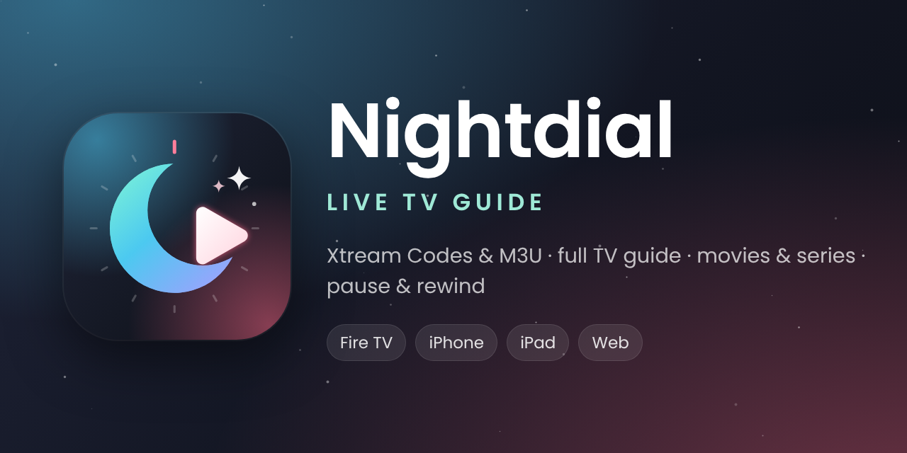

  

  <b>Nightdial</b> is an IPTV player with a full TV guide for <b>Fire TV</b>, <b>iPhone</b>, <b>iPad</b> and the <b>web</b>. 
  Sign in with Xtream Codes or an M3U playlist, browse the guide, watch movies and series, and pause or rewind live TV.

  <a href="https://s515bx.github.io/Nightdial/"><b>Website</b></a> ·
  <a href="https://github.com/S515BX/Nightdial/releases/download/firetv/Nightdial-FireTV.apk"><b>Fire TV app</b></a> ·
  <a href="https://github.com/S515BX/Nightdial/releases/download/ios/Nightdial.ipa"><b>iPhone &amp; iPad app</b></a> ·
  <a href="https://s515bx.github.io/Nightdial/app/"><b>Web player</b></a>

## Features

- **Two ways to sign in**: Xtream Codes (server, username, password) or an M3U playlist link with an optional XMLTV guide link. Compressed `.xml.gz` guides work, and a `get.php` M3U link signs in with Xtream Codes automatically. The app starts empty, with no demo.
- **Full TV guide (EPG)**: a smooth-scrolling grid of what's on now and next. ← goes back through shows that already aired (up to 12 hours), with catch-up where your provider keeps recordings. Search channels and programs, or jump to a channel by number.
- **Movies & Series**: shows up when your subscription includes them. Browse by category, search, see details, seasons and episodes, and pick up where you left off.
- **Pause, rewind and scrub live TV**: press OK while watching for the player panel, like TiviMate: program info, a timeline to scrub with ◀ ▶ (faster the longer you hold), and buttons for pause, ±30 s, back to live, picture shape, audio track and favorites.
- **Playlist options**, kept for each playlist: name, login, guide source (provider or XMLTV), guide time shift, channel numbers (provider's or 1, 2, 3…), sorting, the group it opens on, stream format, User-Agent, Movies & Series on or off, and hiding adult groups.
- **Other video players**: full screen, catch-up and movies can open in VLC or MX Player on Fire TV (or anything installed), and VLC, Infuse or nPlayer on iPhone and iPad.
- **VPN**: on Fire TV, a built-in WireGuard VPN. Send the config from your phone: open the address the TV shows and paste it, with no typing on the remote. Optionally connect when Nightdial starts, or only play when a VPN is on. iPhone and iPad show when your VPN app is on and can hold playback until it is.
- **Picture shape and best picture**: 16:9 (default), Fit, Zoom, Stretch or 4:3. Streams open at their highest quality, and on Fire TV Xtream channels play the provider's original MPEG-TS stream when the account allows it.
- **Your channels, your way**: hold OK on a channel (touch and hold on iPhone, right-click on the web) for its options, like TiviMate: favorites, program details, other airings, another player, rename it, give it your own number, hide it or its group. Favorites in your own order and hidden groups are in Settings → Edit channels.
- **Stream details**: the channel banner and player panel show the resolution (4K, 1080p…), frame rate, video codec and audio (Dolby Digital 5.1, AAC stereo…).
- **Themes**: everyday themes plus holiday themes with their own scenery and particles (bats, snow, leaves, fireworks…) that can switch on in season. Pick highlight and menu colors, fonts and interface size.
- **Smooth on every screen**: menus, lists and the guide glide instead of jumping a page at a time, and the item you're on always has room around it.
- **Private and secure**: passwords, playlist links and the VPN key are stored encrypted on your device (Android Keystore on Fire TV, Keychain on iPhone) and only ever sent to your provider. The app pages run only their own code under a strict content security policy, can't be framed, and Fire TV backups are off.

## Download

| App | Download | Install with |
| --- | --- | --- |
| Fire TV | [Nightdial-FireTV.apk](https://github.com/S515BX/Nightdial/releases/download/firetv/Nightdial-FireTV.apk) | Downloader app or adb |
| iPhone and iPad | [Nightdial.ipa](https://github.com/S515BX/Nightdial/releases/download/ios/Nightdial.ipa) | [Sideloadly](https://sideloadly.io) (signs it with your Apple ID) |
| Web | [Web player](https://s515bx.github.io/Nightdial/app/) or the computer version from the [website](https://s515bx.github.io/Nightdial/#web) | A browser; the computer version runs with `node server.js` |

GitHub builds the apps every time something in `ios/` or `firetv/` changes; only builds from `main` are published. Each release lists the file's SHA-256 so you can check your download.

### Fire TV

1. On the Fire Stick: Settings → My Fire TV → About, select the device name 7 times. Then in **Developer options** turn on **Apps from Unknown Sources** (or allow the Downloader app to install apps).
2. Install the free **Downloader** app from the Amazon Appstore.
3. In Downloader, enter:
   `https://github.com/S515BX/Nightdial/releases/download/firetv/Nightdial-FireTV.apk`
   (or from a computer: `adb connect <fire-stick-ip>` then `adb install -r Nightdial-FireTV.apk`).

New builds install over the old one and keep your playlists and favorites.

**On the remote**

| Button | In the guide | In full screen |
| --- | --- | --- |
| ↑ ↓ | Move between channels | Change channel |
| ← → | Earlier and later programs, back to 12 hours ago | ← channel list |
| OK | Watch, or open program details and catch-up | Player panel: timeline (◀ ▶ to scrub, OK to jump) and buttons (▼) |
| OK (hold) | Channel options: favorites, details, find other airings, another player, rename, change number, hide channel or group, reload guide | |
| ▶❚❚ | Watch the selected channel | Pause and play |
| ◀◀ ▶▶ | Jump a screen earlier or later in the guide | Rewind and fast-forward 30 s |
| Back | Back to the playing channel, then the channel groups (← for the main menu); **press Back twice there to exit** | Clears the channel banner, closes the panel, then back to the guide |
| ☰ | Program details | Channel options (favorite, hide, picture shape, audio, another player) |

### iPhone and iPad (Sideloadly)

1. Download `Nightdial.ipa` on your computer.
2. Install [Sideloadly](https://sideloadly.io). On Windows it needs iTunes and iCloud from Apple's website, not the Microsoft Store versions.
3. Plug in your iPhone, drag `Nightdial.ipa` into Sideloadly, enter your Apple ID and press **Start**.
4. On the iPhone: Settings → General → VPN & Device Management → your Apple ID → **Trust**. Turn on Developer Mode if asked (Settings → Privacy & Security) and restart.
5. With a free Apple ID the app lasts 7 days. Turn on Sideloadly's automatic refresh, or press Start again before then.

On iPhone, most M3U channels need to be HLS (`.m3u8`) streams; Xtream-style `.ts` links are switched to `.m3u8` automatically. Movies in `.mkv` format play on Fire TV and the web but not on iPhone.

### Web

Open the [web player](https://s515bx.github.io/Nightdial/app/). Browsers block plain-`http` IPTV servers on secure web pages, so for most providers use the computer version: download it from the [website](https://s515bx.github.io/Nightdial/#web), run `node server.js` (Node.js 18+) and open http://localhost:8080.

## What's inside

- `firetv/`: Android TV app for Fire TV (Fire OS 5+). Opens in Android Studio.
- `ios/`: SwiftUI app (iOS 16+). Open `Nightdial.xcodeproj` in Xcode 16+ if you have a Mac.
- `web/`: the computer version, with a small Node.js relay for your provider.
- `site/`: the website (home page and web player), published with GitHub Pages.
- `brand/`: the Nightdial logo (`icon.svg`) and the scripts that render the app icons, the Fire TV banner and this page's banner.
- `docs/`: the banner on this page.

Nightdial doesn't include any channels. Use it with a service you subscribe to.
